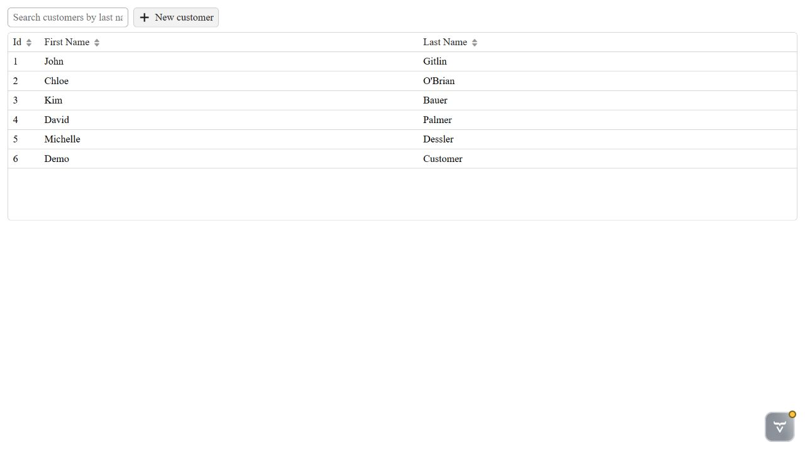
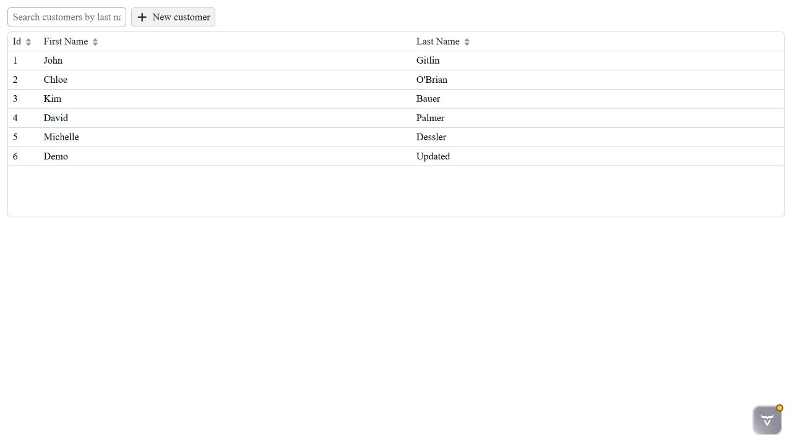
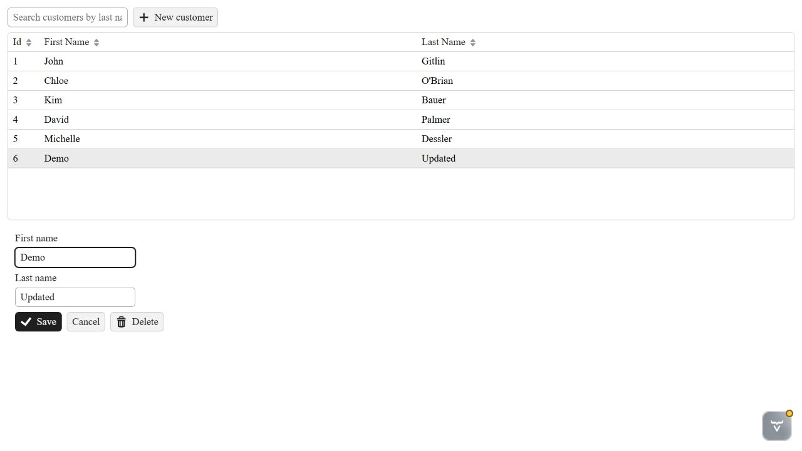
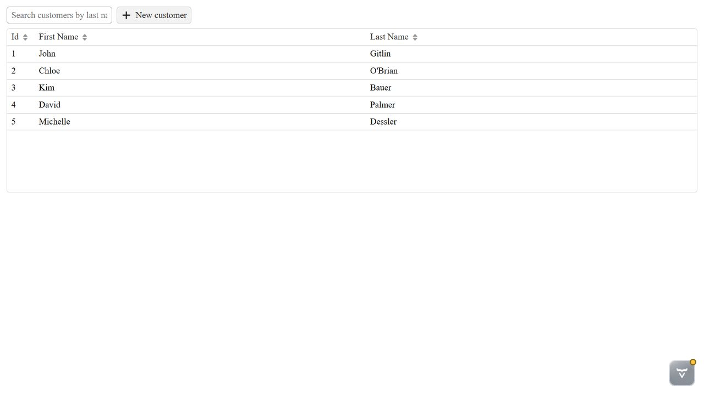
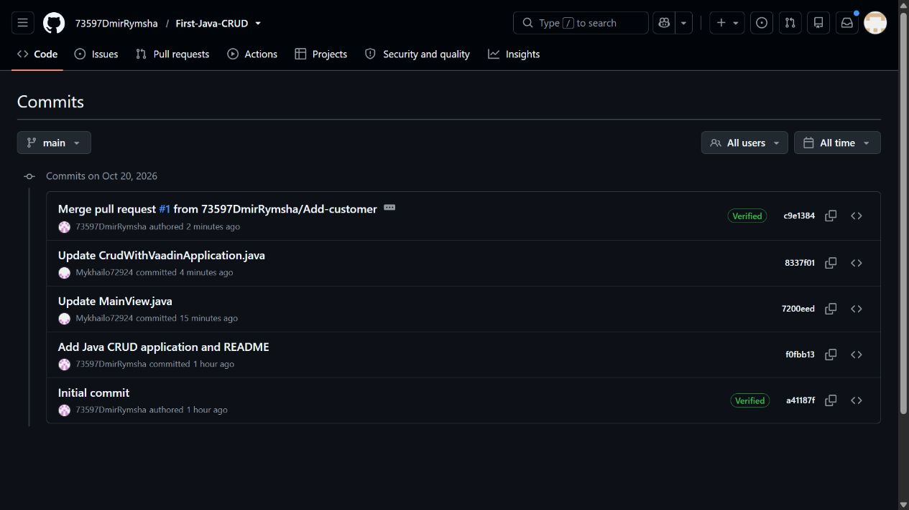
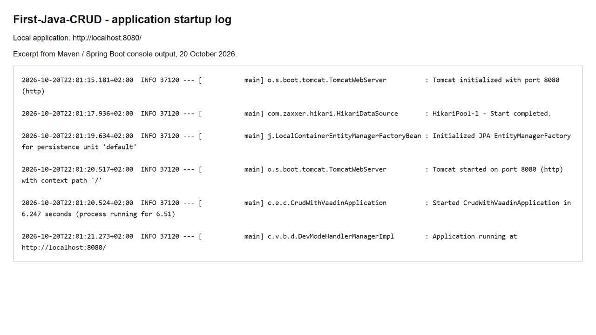

# Application screenshots

Damir Rymsha, student ID 73597. Captured on 20 October 2026.

The application was run locally at http://localhost:8080/ using Java 21 and Maven, after merging Mykhailo's changes.

## Running application (Read)

The customer table displays the five initial records, including John Gitlin from the partner's change.

## Create

Clicking **New customer**, entering `Demo` / `Customer`, and clicking **Save** adds customer 6 to the table.

## Update

Selecting customer 6, changing the last name to `Updated`, and clicking **Save** updates the same record.

## Delete

Selecting the updated record opens the editor with **Save**, **Cancel**, and **Delete** controls.

Clicking **Delete** removes the demonstration record. The original five customers remain.

## Collaboration

The GitHub history shows commits by both `73597DmirRymsha` and `Mykhailo72924`.

- [Mykhailo's merged PR in this repository](https://github.com/73597DmirRymsha/First-Java-CRUD/pull/1)
- [Damir's merged PR in Mykhailo's repository](https://github.com/Mykhailo72924/First-Java-CRUD/pull/1)

## Successful startup

The screenshot displays an excerpt from the actual Maven / Spring Boot console output in a local log viewer. It includes database initialization, Tomcat on port 8080, and the successful application startup message. The same unmodified log lines are saved in [startup-log.txt](startup-log.txt).

